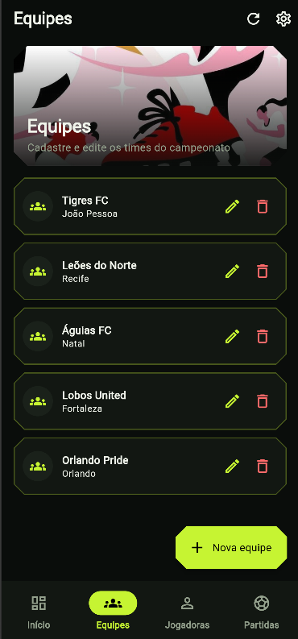
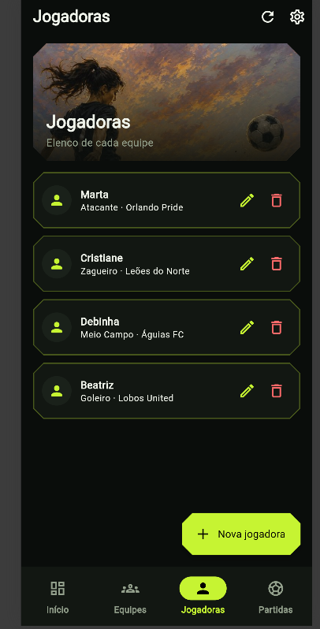
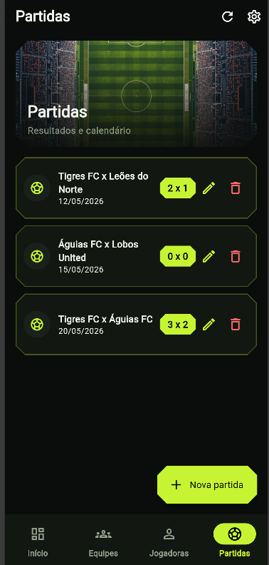
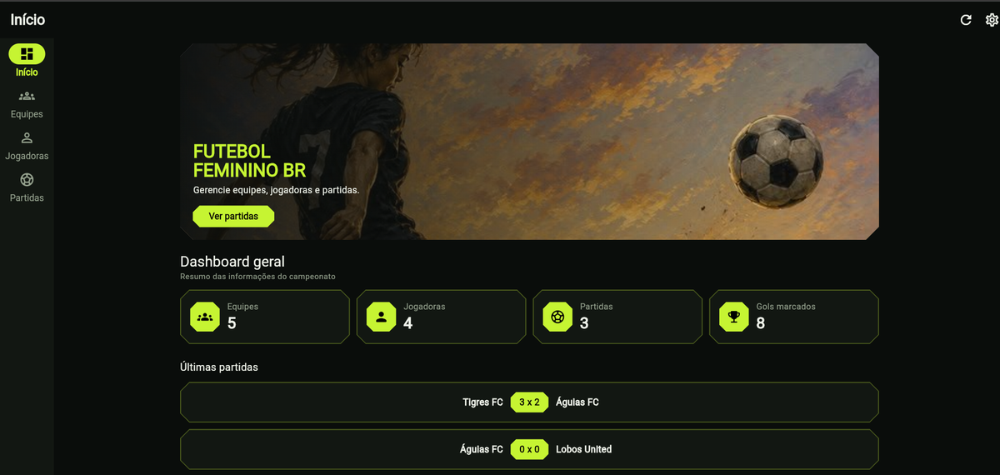

# Futebol Feminino BR — App Flutter + API Flask

Aplicativo **Flutter (Android, iOS e Web)** para gerenciar um campeonato de futebol: cadastro de **equipes**, **jogadoras** e **partidas**, com um **dashboard** de resumo. O app consome a API descrita no exercício prático da disciplina _Desenvolvimento para Aplicativos Móveis_ (UNINASSAU). Este repositório também traz uma **implementação de referência da API em Python + Flask**, para você rodar tudo localmente.

> Projeto acadêmico — Exercício Prático (1,0 ponto extra), entrega individual.

---

## Sumário

1. [Visão geral](#visão-geral)
2. [Origem e inspiração](#origem-e-inspiração)
3. [Funcionalidades](#funcionalidades)
4. [Telas](#telas)
5. [Arquitetura](#arquitetura)
6. [Estrutura de pastas](#estrutura-de-pastas)
7. [Contrato da API](#contrato-da-api)
8. [Instalação das dependências (todos os comandos)](#instalação-das-dependências-todos-os-comandos)
9. [Como executar](#como-executar)
10. [Configurando a URL da API](#configurando-a-url-da-api)
11. [Design e responsividade](#design-e-responsividade)
12. [Imagens otimizadas](#imagens-otimizadas)
13. [Testes](#testes)
14. [Decisões, premissas e limitações](#decisões-premissas-e-limitações)
15. [Solução de problemas](#solução-de-problemas)
16. [Checklist do exercício](#checklist-do-exercício)
17. [Licença](#licença)
18. [Créditos](#créditos)

---

## Visão geral

| Camada             | Tecnologia                                                       |
| ------------------ | ---------------------------------------------------------------- |
| App (mobile + web) | Flutter / Dart, Material 3, pacote `http` e `shared_preferences` |
| API (referência)   | Python 3 + Flask + Flask-CORS                                    |
| Banco de dados     | SQLite (arquivo local `campeonato.db`)                           |

O app **não depende** da API de referência: ele segue o contrato do documento, então funciona com o backend que o professor disponibilizou no Teams, bastando informar a URL.

## Origem e inspiração

- **Exercício prático (PDF):** define as telas de exemplo (dashboard, equipes, jogadores, partidas) e as rotas da API.
- **Conceito de futebol feminino:** inspirado no projeto [`luzialeticia/futebol-feminino-br`](https://github.com/luzialeticia/futebol-feminino-br), uma API criada como projeto final do curso de Back-end da {reprograma}. Ela nasceu da necessidade de um grupo de torcedoras por dados sobre campeonatos, times e jogadoras, já que o futebol feminino brasileiro tem pouca informação pública. O repositório original usa **Node.js + Express + MongoDB (Mongoose)** e é licenciado sob **MIT**.
- **Aqui:** o conceito foi **refatorado do zero** para Flutter/Dart (front) e Python/Flask (back). **Nenhum código do repositório original foi copiado**; os endpoints seguem o PDF do exercício, não os do projeto original.
- **Interface:** layout de três telas (tema escuro, destaque verde-limão, cartões de cantos chanfrados, navegação inferior) usado como **guia visual**. A imagem de referência não é distribuída neste repositório.

## Funcionalidades

- **Dashboard:** total de equipes, jogadoras, partidas e gols marcados, mais as últimas partidas. Todos os valores são **calculados a partir dos dados da API** (gols = soma dos placares de todas as partidas).
- **Equipes, Jogadoras e Partidas:** listar, criar, editar e remover (CRUD completo das 13 rotas do documento).
- Validação de formulários (campos obrigatórios, gols inteiros ≥ 0, equipes da casa e visitante diferentes, data via seletor).
- Confirmação antes de remover.
- _Pull-to-refresh_ e botão de atualizar.
- Estados de carregamento, vazio e erro (com botão "Tentar de novo" e atalho para configurar a URL).
- URL da API configurável dentro do app e salva no dispositivo.
- Layout adaptável: celular, tablet e navegador.

## Telas

### Versão mobile

<table>
  <tr>
    <td align="center"><br><sub><b>Equipes</b></sub></td>
    <td align="center"><br><sub><b>Jogadoras</b></sub></td>
    <td align="center"><br><sub><b>Partidas</b></sub></td>
  </tr>
</table>

### Versão Web

<p align="center">
  
</p>

Na web (largura ≥ 800 px) a navegação inferior vira uma barra lateral e o conteúdo fica centralizado, com estatísticas em 4 colunas.

## Arquitetura

```
┌────────────────────────┐   HTTP/JSON    ┌───────────────────────┐
│  Flutter (mobile/web)  │ ─────────────▶ │  API (Flask ou a do   │
│                        │ ◀───────────── │  professor no Teams)  │
│  screens ─ widgets     │                │          │            │
│     │                  │                │       SQLite          │
│  AppState (ChangeNotif)│                └───────────────────────┘
│     │                  │
│  ApiService (http)     │
└────────────────────────┘
```

- **`ApiService`**: uma função por rota do documento, tratamento de timeout e mensagens de erro legíveis.
- **`AppState`** (`ChangeNotifier` + `InheritedNotifier`): guarda as listas, o estado de carregamento/erro e recarrega os dados após cada escrita. Sem pacotes de gerenciamento de estado extras.
- **Models** tolerantes: aceitam variações de nome de campo (ex.: `id`, `idEquipe`, `id_equipe`).

## Estrutura de pastas

```
.
├── README.md
├── LICENSE
├── pubspec.yaml
├── analysis_options.yaml
├── assets/images/            # imagens otimizadas (variantes _sm e _lg)
├── docs/screenshots/         # capturas de tela usadas no README
├── lib/
│   ├── main.dart
│   ├── core/                 # tema e imagem responsiva
│   ├── models/               # Equipe, Jogador, Partida
│   ├── services/             # ApiService (HTTP)
│   ├── state/                # AppState / AppScope
│   ├── widgets/              # cartões, banner, formulários, configurações
│   └── screens/              # shell, dashboard, equipes, jogadoras, partidas
├── test/
│   ├── models_test.dart
│   └── widget_test.dart
└── backend/
    ├── app.py                # API Flask
    ├── seed.py               # dados de exemplo (opcional)
    ├── requirements.txt
    ├── .env.example
    └── tests/test_api.py
```

## Contrato da API

URL base: `http://IP_DO_SERVIDOR` (ex.: `http://191.252.101.12/`). Todas as rotas usam JSON.

| Recurso   | Método | Rota                      | Corpo enviado                                                                                   |
| --------- | ------ | ------------------------- | ----------------------------------------------------------------------------------------------- |
| Equipes   | GET    | `/listaequipes`           | —                                                                                               |
|           | POST   | `/cadastraequipe`         | `nomeEquipe`, `cidadeEquipe`                                                                    |
|           | PUT    | `/atualizaequipe`         | `idEquipe`, `nomeEquipe`, `cidadeEquipe`                                                        |
|           | DELETE | `/removeequipe`           | `idEquipe`                                                                                      |
| Jogadores | GET    | `/listajogadores`         | —                                                                                               |
|           | POST   | `/cadastrajogador`        | `nomeJogador`, `posicaoJogador`, `idEquipeJogador`                                              |
|           | PUT    | `/atualizajogador`        | `idJogador`, `nomeJogador`, `posicaoJogador`, `idEquipeJogador`                                 |
|           | DELETE | `/removejogador`          | `idJogador`                                                                                     |
| Partidas  | GET    | `/listapartidas`          | —                                                                                               |
|           | GET    | `/listapartidasdetalhada` | —                                                                                               |
|           | POST   | `/cadastrapartida`        | `dataPartida`, `placarEquipeCasa`, `placarEquipeVisitante`, `idEquipeCasa`, `idEquipeVisitante` |
|           | PUT    | `/atualizapartida`        | `idPartida` + campos do POST                                                                    |
|           | DELETE | `/removepartida`          | `idPartida`                                                                                     |

Formato de data: `AAAA-MM-DD`.

### Respostas de listagem

```jsonc
// GET /listaequipes
[{ "id": 1, "nome": "Tigres FC", "cidade": "João Pessoa" }]

// GET /listajogadores
[{ "id": 1, "nome": "Carlos Silva", "posicao": "Atacante", "id_equipe_fk": 1 }]

// GET /listapartidas  (equipes por id)
[{ "id": 1, "dataPartida": "2026-05-20", "placarCasa": 2, "placarVisitante": 1,
   "equipeCasa": 1, "equipeVisitante": 2 }]

// GET /listapartidasdetalhada  (equipes por nome)
[{ "id": 1, "dataPartida": "2026-05-20", "equipeCasa": "Tigres FC",
   "equipeVisitante": "Leões FC", "placarCasa": 2, "placarVisitante": 1 }]
```

> O campo `id` **não aparece** nos exemplos do PDF, mas é necessário para editar/remover. Veja [Decisões e limitações](#decisões-premissas-e-limitações).

### Códigos de status da API de referência

| Status | Quando                                                                      |
| ------ | --------------------------------------------------------------------------- |
| 200    | Consulta, atualização ou remoção bem-sucedida                               |
| 201    | Cadastro bem-sucedido (retorna `id`)                                        |
| 400    | JSON inválido, campo ausente/incorreto, equipe inexistente                  |
| 404    | Registro a atualizar/remover não encontrado                                 |
| 409    | Remoção bloqueada porque o registro está em uso (ex.: equipe com jogadoras) |

## Instalação das dependências (todos os comandos)

Os comandos abaixo valem para **Windows (PowerShell)**; no macOS/Linux, só muda a ativação do ambiente virtual.

### Verificar as ferramentas

```powershell
flutter --version
flutter doctor            # confira Flutter, Chrome e (opcional) Android Studio
python --version          # 3.10 ou superior
```

### Backend (Python)

Dependências: `Flask`, `flask-cors` e `pytest` (listadas em `backend/requirements.txt`).

```powershell
cd backend
python -m venv .venv

# Ativar o ambiente virtual
.venv\Scripts\Activate.ps1          # Windows (PowerShell)
# source .venv/bin/activate         # macOS / Linux

# Se o PowerShell bloquear a ativação, libere só nesta sessão:
# Set-ExecutionPolicy -Scope Process -ExecutionPolicy Bypass

python -m pip install --upgrade pip
pip install -r requirements.txt
```

### App (Flutter / Dart)

Dependências: `http` e `shared_preferences` (runtime); `flutter_test` e `flutter_lints` (desenvolvimento) — todas declaradas no `pubspec.yaml`.

```powershell
# na raiz do projeto (onde está o pubspec.yaml)
flutter create . --project-name futebol_feminino_br --platforms=android,ios,web
flutter pub get
```

Se quiser adicionar as dependências manualmente em outro projeto:

```powershell
flutter pub add http shared_preferences
flutter pub add --dev flutter_lints
```

### Sequência completa (copiar e colar)

```powershell
# 1) Backend — terminal 1
cd backend
python -m venv .venv
.venv\Scripts\Activate.ps1
pip install -r requirements.txt
python seed.py
python app.py

# 2) App — terminal 2 (na raiz do projeto)
flutter pub get
flutter analyze
flutter test
flutter run -d chrome
```

## Como executar

### Pré-requisitos

- Flutter estável recente (testado em design contra o SDK `^3.6`; os formulários usam `initialValue` em `DropdownButtonFormField`, presente nas versões atuais do Flutter)
- Python 3.10+ (apenas se for usar a API de referência)

### 1. Backend (API de referência em Flask)

```bash
cd backend
python -m venv .venv
source .venv/bin/activate          # Windows: .venv\Scripts\Activate.ps1
pip install -r requirements.txt

python seed.py                     # opcional: dados de exemplo do PDF
python app.py                      # sobe em http://0.0.0.0:5000
```

Verifique em `http://localhost:5000/` — deve responder `{"api": "Campeonato Esportivo", "status": "online"}`.

Variáveis opcionais (`.env.example`): `PORT` (padrão 5000) e `DB_PATH` (padrão `backend/campeonato.db`).

### 2. App Flutter

O repositório contém o código do app (`lib/`, `assets/`, `pubspec.yaml`). Gere as pastas de plataforma uma única vez:

```bash
flutter create . --project-name futebol_feminino_br --platforms=android,ios,web
flutter pub get
```

Execute:

```bash
# Navegador
flutter run -d chrome

# Emulador/dispositivo Android
flutter run

# Apontando para outro servidor (ex.: o do professor)
flutter run --dart-define=API_URL=http://191.252.101.12
```

Build web:

```bash
flutter build web
```

#### Android: permitir HTTP (sem TLS)

A API do exercício usa `http://`. Em Android recente o tráfego sem criptografia é bloqueado por padrão. Em `android/app/src/main/AndroidManifest.xml`, adicione ao `<application ...>`:

```xml
android:usesCleartextTraffic="true"
```

Para acesso à internet em builds _release_, confirme também a permissão `<uses-permission android:name="android.permission.INTERNET"/>`.

#### iOS: permitir HTTP

Em `ios/Runner/Info.plist`, libere o domínio/IP do servidor via `NSAppTransportSecurity` (ou use HTTPS).

## Configurando a URL da API

Prioridade: **valor salvo no app** > `--dart-define=API_URL` > padrão da plataforma.

| Onde o app roda                   | URL padrão                                               |
| --------------------------------- | -------------------------------------------------------- |
| Navegador, desktop, simulador iOS | `http://localhost:5000`                                  |
| Emulador Android                  | `http://10.0.2.2:5000` (alias do computador host)        |
| Celular físico                    | `http://<IP-do-seu-computador>:5000` na mesma rede Wi-Fi |

Para alterar em tempo de execução: ícone de engrenagem na barra superior → **URL da API**. O valor fica salvo no dispositivo.

## Design e responsividade

**Base visual:** referência de três telas — fundo quase preto, verde-limão (`#C6F432`) como cor de ação, cartões com **cantos chanfrados** e contorno fino, cabeçalho com imagem de destaque e navegação inferior.

| Largura da tela                  | Comportamento                                                                                                                 |
| -------------------------------- | ----------------------------------------------------------------------------------------------------------------------------- |
| < 600 px (celular)               | Navegação inferior; cartões em 1 coluna; banners em proporção 16:7; estatísticas em 2 colunas                                 |
| 600–799 px (tablet retrato)      | Navegação inferior; banners 16:5; grades de cartões em mais de uma coluna                                                     |
| ≥ 800 px (tablet paisagem / web) | **NavigationRail** lateral; conteúdo centralizado com largura máxima de 1100 px; estatísticas em 4 colunas a partir de 900 px |

Detalhes técnicos:

- Listas usam `SliverGridDelegateWithMaxCrossAxisExtent` (máx. 480 px por cartão), então o número de colunas se ajusta sozinho.
- Formulários são diálogos com largura máxima de 440 px e rolagem, para caber em telas pequenas e com teclado aberto.
- Texto longo é truncado com reticências; botões de ação têm _tooltips_.
- As imagens recebem `semanticLabel` (acessibilidade) e degradê escuro para manter o texto legível.

> Mudança em relação ao PDF: as telas de exemplo usam menu lateral (_drawer_) e AppBar azul. Seguindo a sua instrução de usar a referência de três telas como base, adotei navegação inferior/rail e o tema escuro, mantendo as mesmas quatro áreas (Dashboard, Equipes, Jogadoras, Partidas).

## Imagens otimizadas

As três imagens enviadas foram reaproveitadas. Cada uma foi recortada para o formato em que é usada e exportada em duas variantes JPEG progressivas. O app escolhe a variante pela **largura disponível × densidade de pixels** (`ResponsiveAsset`). Não há _upscaling_: as originais têm ~736 px de largura, então `_lg` é o tamanho nativo.

| Uso no app          | Arquivo            | Recorte                     | `_sm` (480 px)  | `_lg` (nativo)   |
| ------------------- | ------------------ | --------------------------- | --------------- | ---------------- |
| Hero do dashboard   | `hero_painting`    | pintura completa (retrato)  | 480×600 · 50 KB | 735×919 · 108 KB |
| Banner de Jogadoras | `banner_jogadoras` | pintura, jogadora e bola    | 480×201 · 18 KB | 735×308 · 38 KB  |
| Banner de Equipes   | `banner_equipes`   | ilustração, chuteira e bola | 480×202 · 13 KB | 736×309 · 24 KB  |
| Banner de Partidas  | `banner_partidas`  | estádio, círculo central    | 480×202 · 24 KB | 736×309 · 54 KB  |

Por exemplo, a foto do estádio original tinha 206 KB; o recorte usado em tela pequena pesa 24 KB. O recorte do estádio também **remove o selo "8K"** presente na imagem original.

A imagem de interface (três telas) serviu apenas de referência e não está nos _assets_.

## Testes

**Backend** (pytest, 7 testes: CRUD das três entidades, validações, integridade referencial, corpo inválido):

```bash
cd backend
pytest -q
```

**App** (modelos, formatação de data e um teste de widget):

```bash
flutter test
```

## Decisões, premissas e limitações

1. **`id` nas listagens.** O PDF mostra respostas de listagem sem identificador, mas `PUT` e `DELETE` exigem `idEquipe`/`idJogador`/`idPartida`. O app lê `id` (ou `idEquipe`, `idJogador`, `idPartida`, `id_equipe`...). **Se o backend do professor não devolver nenhum id, não é possível editar/remover por ele**; nesse caso o app avisa "A API não retornou o id deste registro". Confirme isso no backend do Teams.
2. **Nomes das equipes nas partidas.** `/listapartidas` traz ids e `/listapartidasdetalhada` traz nomes. O app combina as duas (por `id`, ou pela posição se não houver id). Se a rota detalhada falhar, os nomes são resolvidos pela lista de equipes.
3. **Gols marcados** = soma de `placarCasa + placarVisitante`. Não há rota própria para isso.
4. **Posições** do formulário vêm dos exemplos do PDF (Goleiro, Zagueiro, Meio Campo, Atacante). A API aceita qualquer texto; valores já existentes fora da lista são preservados na edição.
5. **Remoção protegida (API de referência).** Equipe com jogadoras ou partidas não é removida (HTTP 409), para não apagar dados em cascata sem querer.
6. **Sem autenticação.** O documento não prevê login; a API de referência é aberta e destinada a uso local/acadêmico.
7. **`seed.py`** usa os dados que aparecem nas telas do PDF. A associação jogadora → equipe não consta no PDF e foi escolhida só para demonstração.
8. **Validação.** O backend foi testado (7/7 testes passando). O app teve dois erros de tipo na primeira compilação (`ShapeBorder` vs `OutlinedBorder`) e um teste padrão do `flutter create` que referenciava `MyApp`; ambos foram corrigidos na versão 1.0.1 (veja o [histórico](#histórico-de-versões)). Rode `flutter analyze` e `flutter test` e teste em emulador/navegador antes de entregar.

## Solução de problemas

| Sintoma                                         | Causa provável                               | Solução                                                                                     |
| ----------------------------------------------- | -------------------------------------------- | ------------------------------------------------------------------------------------------- |
| "Não foi possível conectar" no emulador Android | `localhost` aponta para o próprio emulador   | Use `http://10.0.2.2:5000`                                                                  |
| Erro só no celular físico                       | Celular fora da rede do servidor ou firewall | Mesma rede Wi-Fi, use o IP da máquina, libere a porta 5000                                  |
| Falha apenas no Android _release_               | HTTP bloqueado ou falta de `INTERNET`        | Veja [Android: permitir HTTP](#android-permitir-http-sem-tls)                               |
| Erro de CORS no Flutter Web                     | Backend sem cabeçalhos CORS                  | A API Flask já usa `flask-cors`; no backend do professor, habilite CORS ou teste em Android |
| Página web em HTTPS chamando API HTTP           | Bloqueio de conteúdo misto                   | Sirva a API em HTTPS ou execute o app web em `http://`                                      |
| Botões de editar/remover avisam sobre id        | A API não devolve id                         | Veja premissa 1                                                                             |
| `flutter test` falha com `MyApp`                 | O `flutter create` gerou o `test/widget_test.dart` padrão | Use o `widget_test.dart` deste repositório (ou apague o gerado)                    |
| Build lento ou erro de arquivo bloqueado        | Projeto dentro do OneDrive (sincronização)   | Mova a pasta para fora do OneDrive (ex.: `C:\dev`) ou pause a sincronização                  |

## Checklist do exercício

- [x] App em Flutter com CRUD de **todas as rotas** do documento (equipes, jogadores, partidas)
- [x] Comunicação com API via HTTP/JSON, URL base configurável
- [x] Telas: Dashboard, Equipes, Jogadores, Partidas
- [x] Imagens enviadas incorporadas e otimizadas para mobile e web
- [x] Layout responsivo (celular, tablet, web)
- [x] README detalhado e licença
- [x] Backend alternativo em Python + Flask
- [x] Executar `flutter analyze` / testar em dispositivo e confirmar o formato real das respostas do backend do Teams
- [x] Preencher seu nome no `LICENSE`
- [x] Entregar até **05/11/2026 às 23:59**

## Histórico de versões

- **1.0.2** — Formulários reescritos como `StatefulWidget` (controllers descartados no `dispose`, não mais logo após o `showDialog`) e moldura de diálogo própria, sem `AlertDialog`; erros da API passam a aparecer dentro do formulário. Corrige a tela vermelha `_dependents.isEmpty` ao criar/editar.
- **1.0.1** — Corrige `chamfer()` para retornar `BeveledRectangleBorder` (compatível com `FilledButton.styleFrom(shape:)`), erro apontado por `flutter analyze`; substitui o `widget_test.dart` padrão (`MyApp`) por um teste de widget do app.
- **1.0.0** — Versão inicial.

## Licença

Código distribuído sob a **licença MIT** — veja [LICENSE](LICENSE).

## Créditos

- **Exercício e documentação da API:** Prof. Joseph Donald — UNINASSAU, Ciências da Computação.
- **Inspiração conceitual:** [`luzialeticia/futebol-feminino-br`](https://github.com/luzialeticia/futebol-feminino-br) (MIT), projeto final do curso de Back-end da {reprograma}.
- **Imagens** (`assets/images/`): fornecidas pela autora do projeto, obtidas no Pinterest. Os criadores originais não foram identificados e **os direitos permanecem com eles**. Uso aqui é acadêmico; **substitua ou obtenha autorização antes de publicar** o app ou o repositório.
- **Referência de interface:** layout de três telas do Pinterest, usado apenas como guia visual e não incluído.
